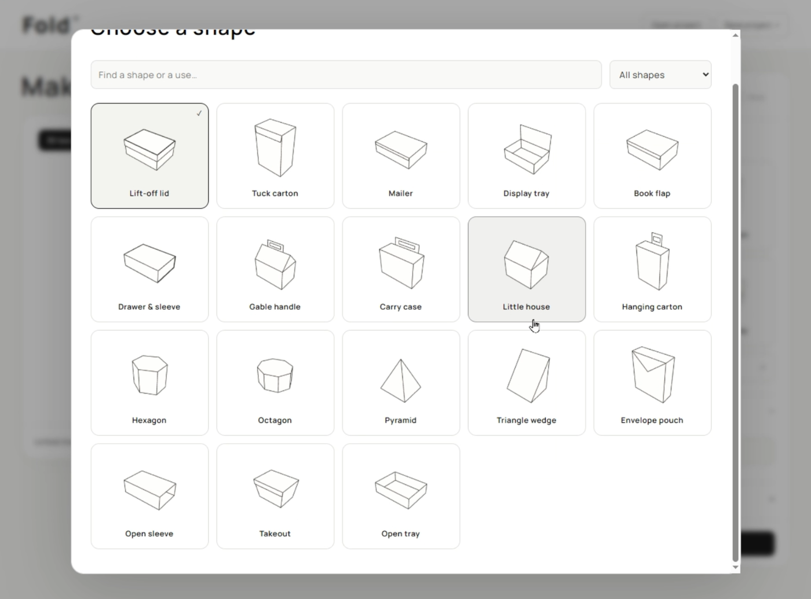
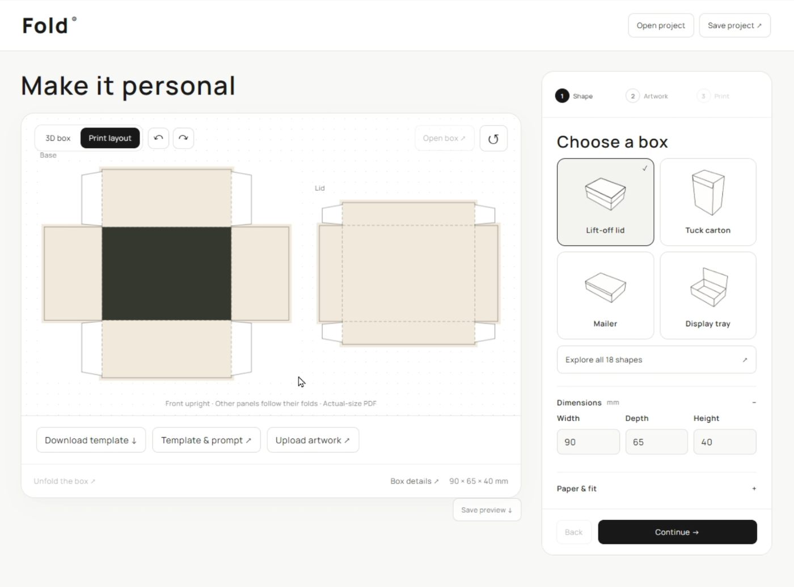
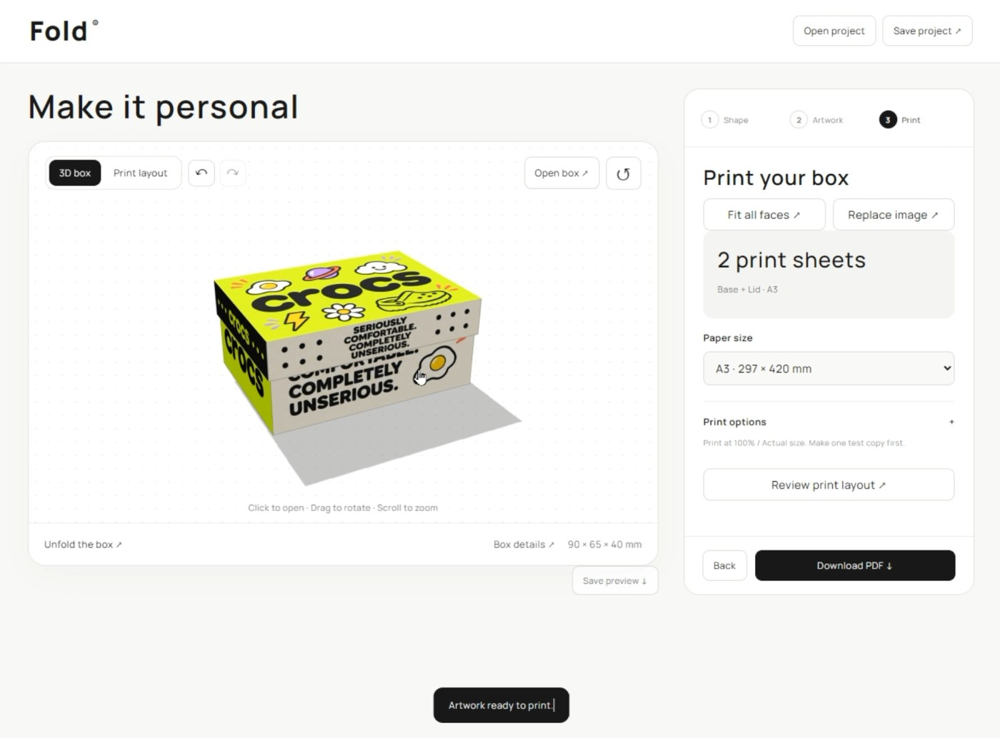
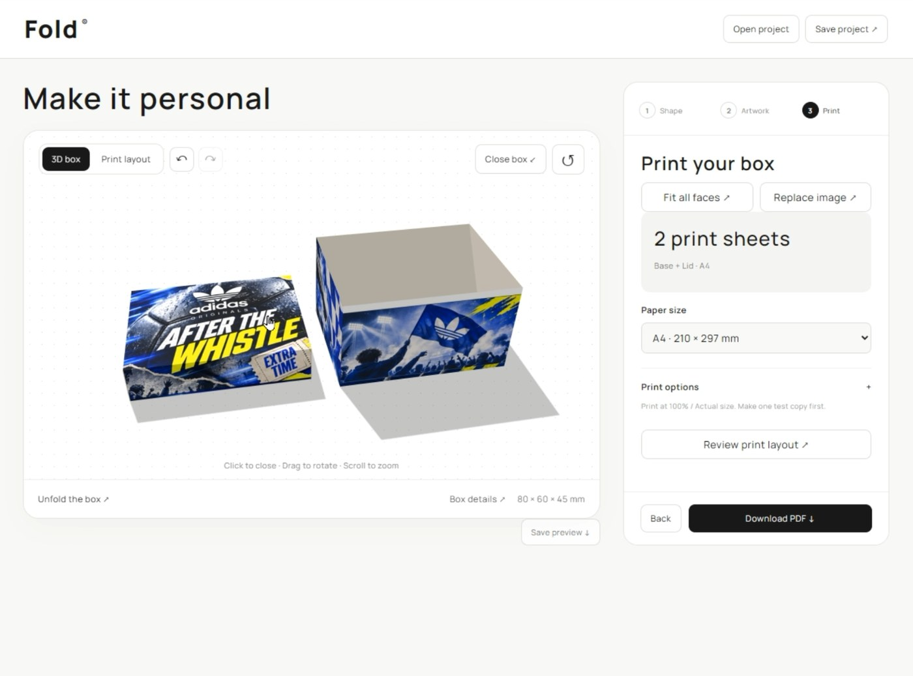
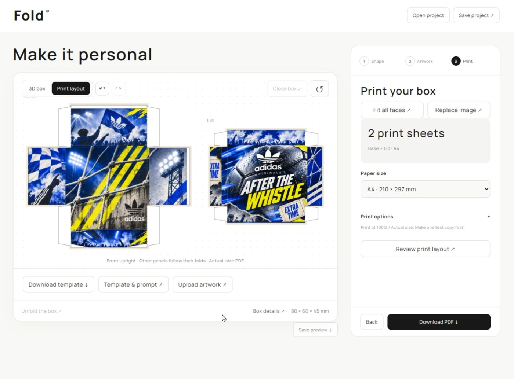

# Fold Studio
Browser packaging prototype. Current English workflow: Shape → Artwork → Print.

Choose one of 18 box shapes, download a template and prompt, create the artwork in ChatGPT Images or another editor, upload it, and see it on a 3D box you can rotate and open. Export a PDF with cut and fold lines at actual size for a test print.

## Screenshots

**1. Choose one of 18 shapes**



**2. Download the blank template and prompt**



**3. Upload the artwork and see it on the 3D box**



**4. Open the box and check every side**



**5. Review the print layout and download the PDF**



## Start
Windows: double-click start.cmd. It installs dependencies on first run, then starts the editor.
Node.js LTS must be installed first; the script explains this if it is missing.
On macOS/Linux run npm start (or node start.mjs).
First launch requires internet. Later launches reuse installed libraries; a changed lockfile triggers an automatic reinstall.
Open the URL printed in the terminal. Close with Ctrl+C.

Website visitors do not install Node.js or npm. Deploy dist to a static web host; bundled libraries load in the browser as part of the site.
Downloading source from GitHub and visiting a hosted site are different workflows.

Manual developer installation:
Requires Node.js 20.19+ or 22.12+ and npm. In this directory:
```powershell
npm.cmd ci
npm.cmd run dev -- --port 4189
```
Open http://127.0.0.1:4189/. On macOS/Linux use npm instead of npm.cmd.
Default port without override is 4188. Use HTTP, not file://.
Build: npm.cmd run build
Preview: npm.cmd run preview -- --port 4189
`npm run build` writes dist/; serve its contents at the domain root.

## Workflow
1. Choose one of 18 constructions and dimensions in mm.
2. Download the blank labeled PNG and copy the prompt; add personal wishes.
3. Create artwork externally in ChatGPT Images or another editor using template and optional references/logo.
4. Upload full-canvas artwork; the app maps it onto all faces and opens Print.
5. Inspect 3D, rotate/zoom, open/close, inspect Print layout, use Fit all faces if needed.
6. Export PDF with vector cut/fold guides at actual size. A4/A3/Letter can tile; custom sheet keeps full net on one larger page.
Save/Open JSON includes images; browser autosave depends on quota. Session undo/redo supported.
No backend/API key/built-in AI generation. External generation has its own access and billing conditions. Fonts and runtime assets are local.

## Validation
At handoff 2026-11-16: build and all following commands passed:
```powershell
npm.cmd run audit
npm.cmd run audit:opening
npm.cmd run audit:shape
node audit-face-fit.mjs
node audit-artwork-transform.mjs
node audit-template-prompt.mjs
```
`audit:shape` (audit-shape-integrity.mjs) verifies the box signature
(shape/width/depth/height/thickness/window/closure) invalidates both the artwork
cache and the undo stack together, that stale in-flight uploads are discarded, and
that fit adjustments with an unchanged signature keep their cache and history.
Computational geometry checks do not establish real paper buildability. Physical assembly, stock, glue, load and closure fit need testing.
Print at 100% / Actual size. PDF is RGB, not certified CMYK/prepress output.
AI may shift boundaries, distort text/logos or ignore orientation; fitting cannot repair illustration content.
Large boxes require tiled pages or a print shop. Do not silently shrink them to A4.
Manual Brand/Design UI, per-face editing, brandbook import and Make Magic are removed.

## Handoff
Read CODEX_HANDOFF.md to continue.
DEVELOPMENT_HISTORY.md is historical and includes removed features.
Source, lockfile, public fonts/assets, upstream and reference boards are included.
node_modules, git history, local user projects, browser caches and generated brand demos are omitted. npm ci restores dependencies.

## Provenance
Adapted partly from https://github.com/riavijay/boo-tique (the hinged panel-tree folding approach and the flattened print projection); original is in upstream/boo-tique.html. The character drawing that was also adapted has been removed.
No explicit upstream license has been established. Clarify permission before public distribution; no license is asserted over upstream code. Internal development handoff only.
Manrope: public/fonts/OFL.txt. Dependencies retain their own licenses.

